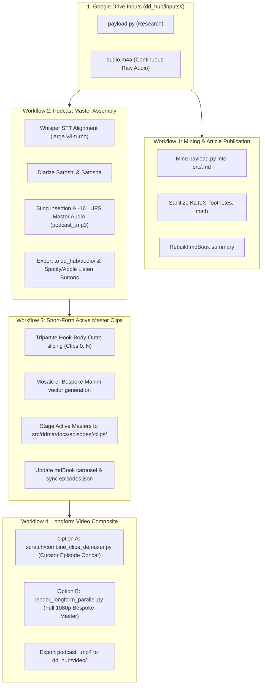

# DeepDive Automated Pipeline: Trigger Contract & Docker Watcher Specification

**Document Owner**: Ashutosh & Antigravity  
**Location**: `deepDive/TRIGGER_CONTRACT.md`  

---

## 1. Overview & Vision

In the headless / Docker production architecture, human interaction through web UI scaffolding (`cockpit.html`, `curator.html`) is eliminated or kept strictly for optional inspection. The pipeline runs continuously inside containerized environments watching Google Drive (`dd_hub`) input folders and automatically orchestrating the 4 core workflows from ingestion to publication.

---

## 2. The Four Pipeline Workflows

### Workflow 1 (W1): Ingestion & Article Mining
- **Inputs**: `dd_hub/inputs/<slug>/payload.py`
- **Trigger**: File arrival in `dd_hub/inputs/<slug>/`
- **Execution**: Runs `ingest/server.py` extraction logic, sanitizes KaTeX math, creates `src/<ep>.md`, updates `src/SUMMARY.md`.
- **Output**: mdBook article published.

### Workflow 2 (W2): Audio Podcast Production
- **Inputs**: Raw continuous audio (`audio.m4a` / `audio.wav`).
- **Trigger**: Completion of W1 or audio presence.
- **Execution**: Faster-Whisper transcription with word timestamps (`transcription.json`), intro/outro/mid-sting assembly (`podcast_edit.json`), loudness normalization to -16 LUFS stereo MP3 (`podcast_<ep>.mp3`).
- **Output**: Exported to `dd_hub/audio/`, triggers `update_listen_buttons.py` for Spotify, Apple, Fountain.fm.

### Workflow 3 (W3): Short-Form Active Master Clips (9:16 Reels)
- **Inputs**: `transcription.json`, `plan.json`, canonical audio (`audio.m4a`).
- **Trigger**: Verified `plan.json` chapter boundaries.
- **Execution**: Tripartite assembly (0-based indexing: Hook, Body, curiosity bridge Outro card max 5 words, pure black cards). Compiled with 100% Mosaic or 100% Manim (`visual_source` in `plan.json`).
- **Output**: Staged to `src/ddma/docs/episodes/<ep>/clips/<ep>-<clip>.mp4`, verified against the 3-point live check (GitHub Pages, `episodes.json` + `plan.json`, Muse agent).

### Workflow 4 (W4): Longform Video Master (16:9 HD)
- **Canonical Renderer**: `scratch/combine_clips_demuxer.py` (Curator chapter-bridge demuxer concatenation of locked clips) or `render_longform_parallel.py` (full 1080p bespoke Manim composition).
- **Trigger**: All episode clips locked / episode compilation invoked (`/combine-project-video?id=<ep>`).
- **Output**: `podcast_<ep>.mp4` + 1920x1080 thumbnail exported to `dd_hub/video/` for YouTube, Spotify, and TikTok distribution.

---

## 3. Docker Watcher Daemon Specification

The automated Docker container runs an asynchronous watcher process (e.g. `python watcher.py`):
1. **Watch Directory**: Polls `DD_HUB_ROOT/inputs/` every 10 seconds.
2. **Atomic Trigger Marker**: Looks for `<slug>.ready` or verifies stability of `payload.py` and `audio.m4a` (file size unchanged for 10s).
3. **Execution Pipeline**:
   - Executes W1 (`ingest/server.py` headless mining).
   - Executes W2 (whisper alignment + podcast mastering).
   - Executes W3 (DDMA clip compilation for all chapters in plan).
   - Executes W4 (`combine_clips_demuxer.py` or parallel compositor).
   - Commits and pushes `deepDive` to GitHub remote.
   - Cleans temporary artifacts and emits telemetry log to `dd_hub/logs/<slug>.log`.
